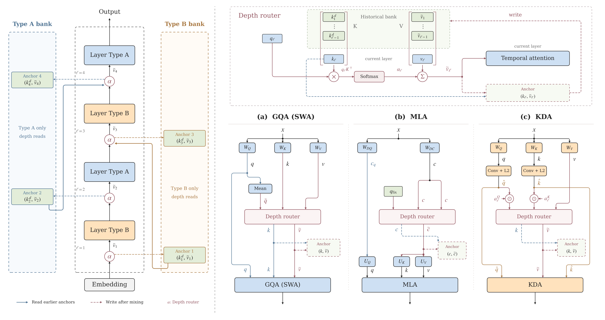
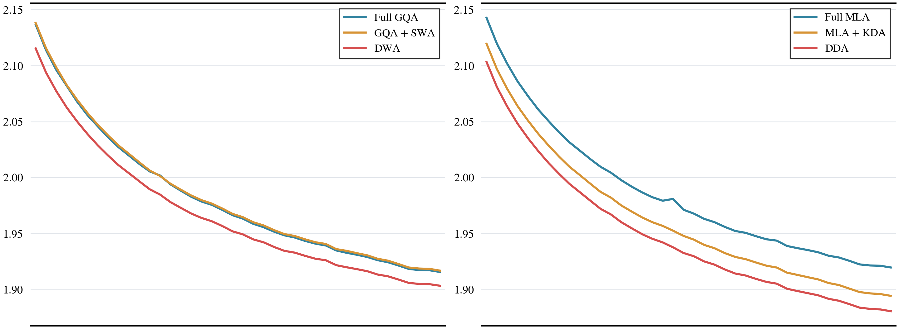
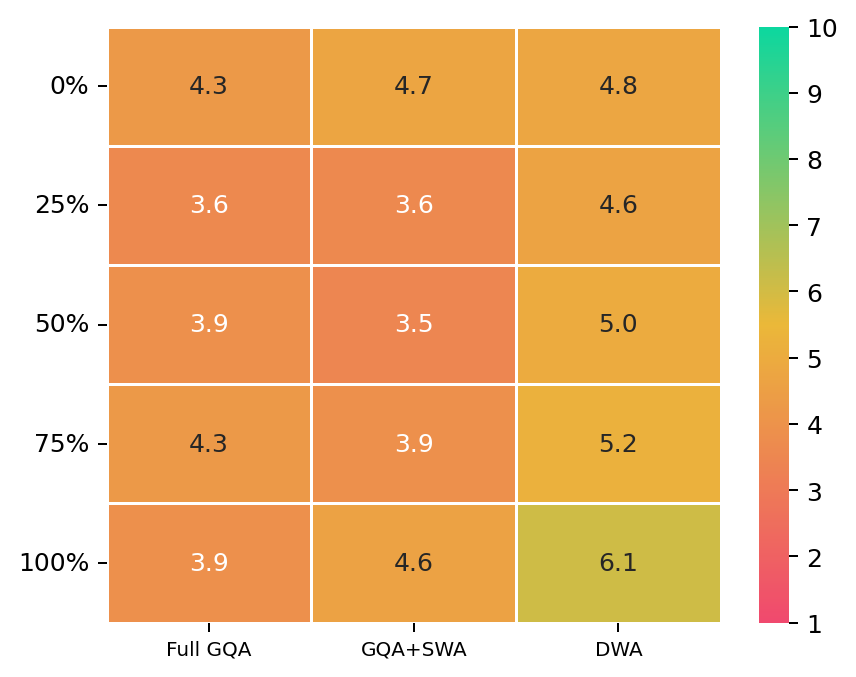
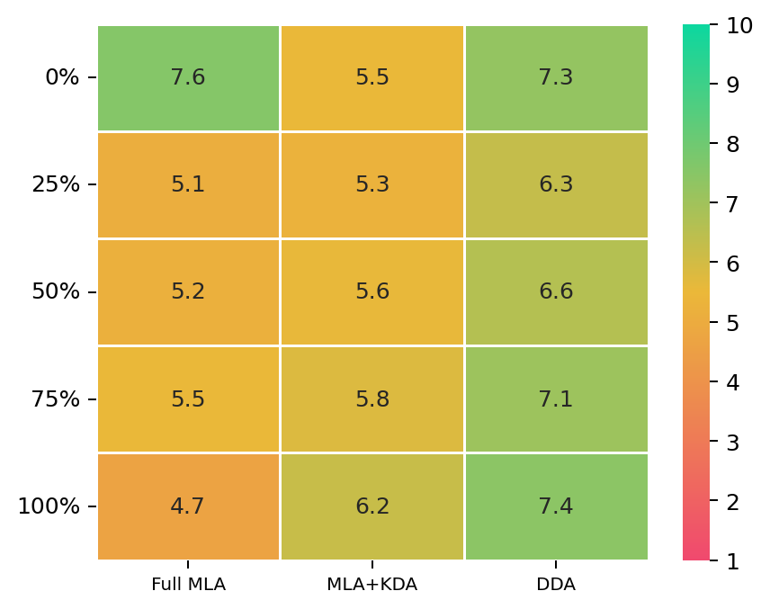

  

  
  

# Depth Hybrid Attention

**Depth Hybrid Attention (DHA)** is an architectural design that outperforms the Full Attention architecture while retaining the efficiency advantages of the Hybrid Attention architecture. It enables each attention layer to selectively reuse representations from earlier depths before applying its temporal attention. Depth Hybrid Attention enhances the scope of temporal attention by facilitating information exchange between attention layers, without affecting the design in the Hybrid Attention architecture for efficient temporal attention.

  

## Overview

In Depth Hybrid Attention, the forward pass for a token maintains a **depth bank** used exclusively by that token, which stores **KV anchors** from preceding executed layers. In each attention layer, the **depth router** performs the following steps sequentially before the temporal attention:

* **(1) Read**: Read historical anchors from the depth bank.

* **(2) Mix**: Perform value mixing in the form of attention.
  
* **(3) Write**: Write the current layer’s anchors to the depth bank.
  
The mixed values are then used for temporal attention. Unlike the temporal KV cache, the depth bank does not require persistent storage that grows as the context length increases.

The [Depth-Attention](https://arxiv.org/abs/2606.05014) has been validated in full Grouped-Query Attention architecture, while the Hybrid Attention architecture combines global layers (whose storage requirements grow with context length) and local layers (whose storage requirements remain bounded) in specified proportions. The challenge is how to adapt Depth-Attention to different types of layers while preserving the efficiency advantages of the layer design for temporal attention. We consider two hybrid architectures, each with depth routing adapted to its constituent layers:

* **Depth Window Attention (DWA)** combines Grouped-Query Attention (GQA) and Sliding-Window Attention (SWA) with depth routing at KV-group granularity. Full-attention and window layers use separate depth banks, so each reads anchors only from its own layer type. The SWA layers retain their sliding temporal window.

* **Depth Delta Attention (DDA)** combines Multi-head Latent Attention (MLA) and Kimi Delta Attention (KDA) with separate depth banks, so each reads anchors only from its own layer type. MLA routes in latent space; KDA mixes values across depths using normalized queries and keys with depth-specific logit scaling before its delta-attention computation.

## Results

### Short Context Benchmark Performance

<table>
  <thead>
    <tr><th align="center">Category</th><th align="center">Benchmark</th><th align="center">Full GQA</th><th align="center">GQA + SWA</th><th align="center">DWA (Ours)</th></tr>
  </thead>
  <tbody>
    <tr><td align="center" rowspan="4">PPL-based</td><td align="center">ARC-Challenge</td><td align="center">35.41</td><td align="center">37.54</td><td align="center"><strong>37.97</strong></td></tr>
    <tr><td align="center">HellaSwag</td><td align="center">46.66</td><td align="center">47.13</td><td align="center"><strong>48.05</strong></td></tr>
    <tr><td align="center">MMLU</td><td align="center"><strong>46.19</strong></td><td align="center">45.17</td><td align="center">45.51</td></tr>
    <tr><td align="center">CMMLU</td><td align="center">41.77</td><td align="center">41.34</td><td align="center"><strong>42.58</strong></td></tr>
    <tr><td align="center" rowspan="4">Generation-based</td><td align="center">GSM8K</td><td align="center">37.60</td><td align="center">38.36</td><td align="center"><strong>44.43</strong></td></tr>
    <tr><td align="center">MBPP</td><td align="center">29.97</td><td align="center">29.87</td><td align="center"><strong>30.38</strong></td></tr>
    <tr><td align="center">CMATH</td><td align="center">48.72</td><td align="center">45.17</td><td align="center"><strong>49.64</strong></td></tr>
    <tr><td align="center">MMLU-Pro</td><td align="center">18.18</td><td align="center">18.16</td><td align="center"><strong>18.91</strong></td></tr>
    <tr><td colspan="2" align="center">Average</td><td align="center">38.06</td><td align="center">37.84</td><td align="center"><strong>39.68</strong></td></tr>
  </tbody>
</table>

<table>
  <thead>
    <tr><th align="center">Category</th><th align="center">Benchmark</th><th align="center">Full MLA</th><th align="center">MLA + KDA</th><th align="center">DDA (Ours)</th></tr>
  </thead>
  <tbody>
    <tr><td align="center" rowspan="4">PPL-based</td><td align="center">ARC-Challenge</td><td align="center">37.03</td><td align="center">38.05</td><td align="center"><strong>39.93</strong></td></tr>
    <tr><td align="center">HellaSwag</td><td align="center">47.02</td><td align="center">47.86</td><td align="center"><strong>48.29</strong></td></tr>
    <tr><td align="center">MMLU</td><td align="center">45.96</td><td align="center">47.74</td><td align="center"><strong>48.13</strong></td></tr>
    <tr><td align="center">CMMLU</td><td align="center">42.41</td><td align="center">43.80</td><td align="center"><strong>44.87</strong></td></tr>
    <tr><td align="center" rowspan="4">Generation-based</td><td align="center">GSM8K</td><td align="center">37.98</td><td align="center">38.21</td><td align="center"><strong>43.67</strong></td></tr>
    <tr><td align="center">MBPP</td><td align="center">29.35</td><td align="center">30.48</td><td align="center"><strong>30.79</strong></td></tr>
    <tr><td align="center">CMATH</td><td align="center">46.17</td><td align="center">47.18</td><td align="center"><strong>51.64</strong></td></tr>
    <tr><td align="center">MMLU-Pro</td><td align="center">19.55</td><td align="center">19.66</td><td align="center"><strong>20.06</strong></td></tr>
    <tr><td colspan="2" align="center">Average</td><td align="center">38.19</td><td align="center">39.12</td><td align="center"><strong>40.92</strong></td></tr>
  </tbody>
</table>

### Loss Curve

  

### Long Context Retrieval Performance
  

    
    
  

## Contact

If you have any questions, please raise an issue or contact us at [nanbeige@kanzhun.com](mailto:nanbeige@kanzhun.com).

